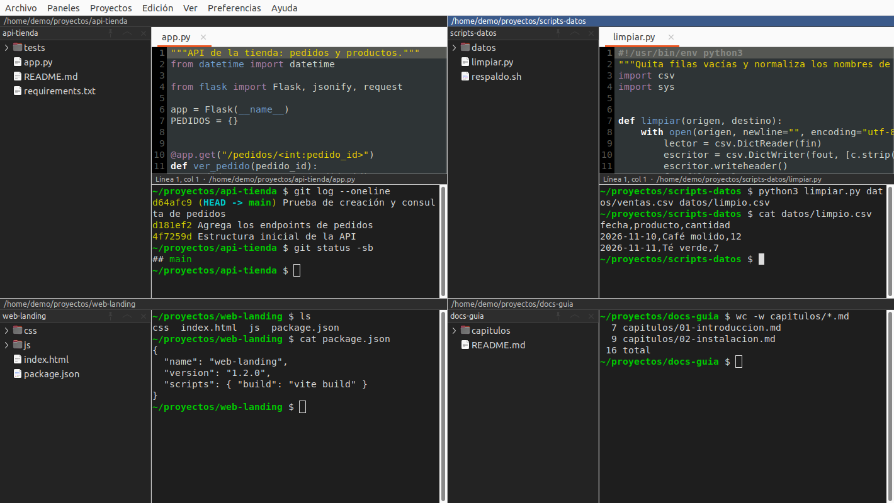
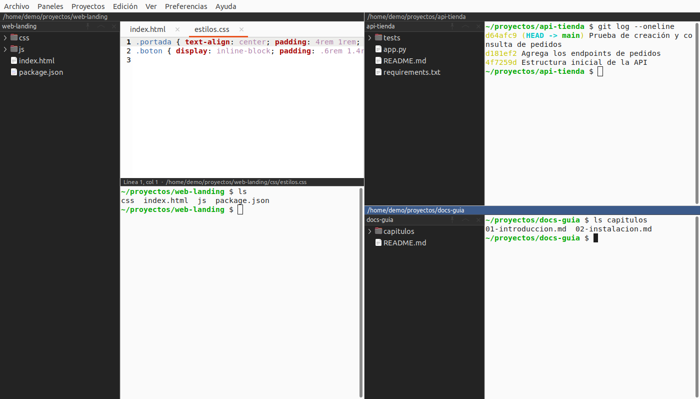
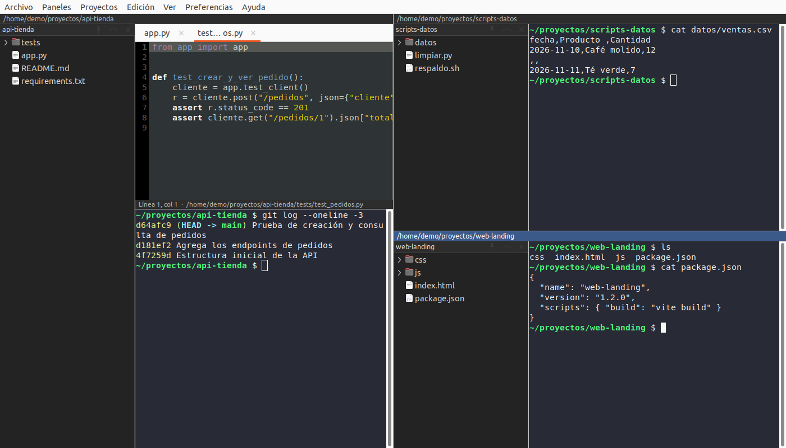

# Pytrol

[](https://github.com/saraivaruas/pytrol/actions/workflows/tests.yml)
[](https://github.com/saraivaruas/pytrol/actions/workflows/paquetes.yml)
[](LICENSE)


**Advanced Python Terminal: Power, Speed, Control.**

Pytrol is an advanced terminal for Linux written in Python with GTK 3 and VTE (the same engine as GNOME Terminal). One project per pane, a file tree beside every terminal, an editor built into each pane, and a session that survives a crash. 🇪🇸 [Versión en español](README.md) (the interface is in Spanish).



## Features

- **Split panes** in 2, 4, 6 or 8, vertical or horizontal, with independent dividers per row or column.
- **A different project in each pane**, with a header showing its folder and a recent-projects list.
- **File tree in every pane**: updates itself, follows the shell's directory, double-click enters a folder or opens a file; context menu to insert a path, open a new pane or tab, show hidden files.
- **Built-in editor** per pane: tabs per file, syntax highlighting, line numbers, `Ctrl+S` to save, warns before closing unsaved changes.
- **Persistent session**: tabs, splits, folders, open files and the **contents of every terminal** are saved every 5 seconds and restored after a normal close or a crash. A pane can be marked «don't remember», and *File → Quit without saving the session* starts clean.
- **`sudo` and `ssh` without a terminal**: when a script or a tool with no terminal runs them, Pytrol shows a password window instead of failing with «a terminal is required».
- Reorderable tabs that inherit the current directory, full menu bar, editable shortcuts, four color schemes (qterminal dark, Dracula, Solarized, light), 24-bit color and clickable links.

| | |
|---|---|
|  |  |

## Install

From the source tree, without `sudo` (installs to `~/.local`):

```bash
./install.sh
pytrol
```

It needs `python3-gi`, `gir1.2-gtk-3.0`, `gir1.2-vte-2.91` and (optional, for syntax highlighting) `gir1.2-gtksource-4`; the script installs them with apt if they are missing.

**Flatpak:** see the *Construir el Flatpak* section of the [Spanish README](README.md#construir-el-flatpak) (Flathub submission is prepared in `flathub/`).

**Snap:** `snap/snapcraft.yaml` builds a **classic** snap (core22), classic because a terminal's shell must run on your system. Build and install:

```bash
./scripts/construir-snap.sh classic
sudo snap install --dangerous --classic ./pytrol_*_amd64.snap
```

A **beta** variant in `devmode` (`./scripts/construir-snap.sh beta`) can go to the Snap Store's beta and edge channels without manual review; its shell runs over core22's file system, so it is only good for testing. Details in [packaging/PUBLICAR.md](packaging/PUBLICAR.md) (Spanish).

## Shortcuts

All of them can be changed in *Preferences → Keyboard shortcuts*.

| Action | Default |
|---|---|
| New tab / close tab | `Ctrl+Shift+T` / `Ctrl+Shift+W` |
| Split vertically / horizontally | `Ctrl+Shift+R` / `Ctrl+Shift+D` |
| Close pane | `Ctrl+Shift+X` |
| Move between panes | `Alt+arrows` |
| Open project in this pane / in a new tab | `Ctrl+Shift+O` / `Ctrl+Shift+P` |
| Open a file in the editor | `Ctrl+Shift+F` |
| Editor: save / close / back to terminal | `Ctrl+S` / `Ctrl+W` / `Esc` |
| Copy / paste | `Ctrl+Shift+C` / `Ctrl+Shift+V` |
| Zoom | `Ctrl +` / `Ctrl -` / `Ctrl 0` |
| Show or hide the menu bar / the project trees | `Ctrl+Shift+M` / `Ctrl+Shift+E` |
| Full screen | `F11` |

## Contributing and security

Every change goes through a Pull Request: see [CONTRIBUTING.md](CONTRIBUTING.md). Report vulnerabilities privately: see [SECURITY.md](SECURITY.md). MIT licensed.
